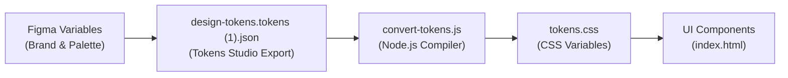

# Liz's Grillz Bookings

An online event booking and catering management system for **Liz's Grillz**, a premier Lagos caterer serving corporate offices, churches, and individuals.

---

## Overview

Today, catering bookings and transfers happen over WhatsApp threads where details and payment receipts easily get lost. **Liz's Grillz Bookings** complements WhatsApp by providing a single link where clients can:
1. Verify live event date availability against real kitchen capacity.
2. Select menu items from a transparent, fixed price list.
3. Pay deposits securely online (60% for offices/churches, 80% for individuals) with immediate payment gateway confirmation and receipt generation.

---

## Design System & Architecture

This repository implements a **2-Tier Design Token Architecture** ensuring consistency, accessibility, and a single source of truth across design and code.



### 1. Color System (Primitives vs. Color Roles)
- **Brand Seed & Contrast**: The brand orange was sampled from the Liz's Grillz logo (`#D75C19`). Because white text on `#D75C19` measured ~3.9:1 (failing the 4.5:1 WCAG AA threshold), it was darkened to `#C2410C` (~5.2:1 contrast ratio) and pinned as **primary 40** so the entire tonal scale generated around it.
- **Primitives (`--color-primitive-*`)**: Foundational 0–100 mathematical tonal palettes (`primary`, `secondary`, `tertiary`, `neutral`, `neutral-variant`, `error`, `warning`). **Internal reference only; never used directly on the UI.**
- **Color Roles (`--color-*`)**: Semantic tokens (`primary`, `on-primary`, `surface`, `on-surface`, `background`, `outline`, `error`, etc.) mapped dynamically to primitives via `var()`. **All UI elements consume Color Roles exclusively.**

### 2. Typographic Scale
- 15 responsive typographic styles in **DM Sans** (`display`, `headline`, `title`, `body`, `label` across `large`, `medium`, and `small`) with defined font-size, line-height, letter-spacing, and font-weight.

### 3. Elevation & Shadows
- `--shadow-soft`, `--shadow-medium`, and `--shadow-hard` constructed using tinted primary color drop shadows rather than harsh neutral black.

---

## Token Pipeline & Usage

### Compile Tokens to CSS
```bash
node convert-tokens.js
# or via npm
npm.cmd run build:tokens
```

### Watch Mode (Continuous Sync)
Automatically recompiles whenever the Figma tokens JSON updates:
```bash
node convert-tokens.js --watch
```

---

## Repository Structure

```text
.
├── .gitignore                      # Git ignore file (node_modules, logs, OS files)
├── README.md                       # Repository overview & documentation
├── convert-tokens.js               # Node.js design token conversion script
├── design-tokens.tokens (1).json   # Figma design tokens source JSON
├── index.html                      # Simple home page screen built using tokens
├── package.json                    # Project metadata & npm scripts
├── tokens-preview.html             # Interactive visual showcase of design tokens
├── tokens.css                      # Generated CSS custom properties
│
└── task-01-design-system/          # Task 1 deliverables & assessment artifacts
    ├── business-brief.md           # Business brief & operational rules
    ├── convert-tokens.js           # Token compiler copy
    ├── design-tokens.tokens (1).json # Tokens source JSON copy
    ├── index.html                  # Home page copy
    ├── tokens-preview.html         # Preview copy
    ├── tokens.css                  # Generated CSS copy
    ├── docs/                       # Project documentation & assessment notes
    │   ├── README.md               # Task 1 summary & decisions
    │   ├── business-brief.md       # Business requirements specification
    │   ├── defects.md              # Known defects & production risk analysis
    │   ├── interview answers.md    # Assessment interview answers
    │   ├── prompts.md              # Verbatim record of agent prompts
    │   ├── regression-note.md      # Deliberate regression & token experiment notes
    │   └── evidence-12-git-log-branch-unmerged.txt # Git log evidence of experiment branch
    └── evidence/                   # Assessment evidence artifacts
        ├── 07-raw-value-search.txt # Search report proving no raw hex codes on UI
        ├── 07-raw-value-search.jpg # Screenshot of token primitives in IDE
        ├── 08-agent-typography-answer.txt # Typography validation report
        ├── 09-screen-without-system.png   # Screen baseline without design system
        ├── 10-screen-with-system.png      # Screen built strictly with design system
        ├── 11-broken-referencing.png/     # Screenshots of broken token experiment
        └── liz's-grillz-booking-first push.txt # Git proof of initial push
```

---

## Verification & Assessment Compliance

1. **Zero Hardcoded Values**: The UI implementation in `index.html` uses zero raw hex colors, arbitrary pixel typography, or unmapped shadows.
2. **Regression Testing**: An experiment branch (`experiment-broken-token`) was tested to verify that hardcoded values break on rebrand while tokenized roles follow the source change.
3. **Accessibility**: All text color role pairings meet or exceed WCAG 2.1 AA standards for contrast.
