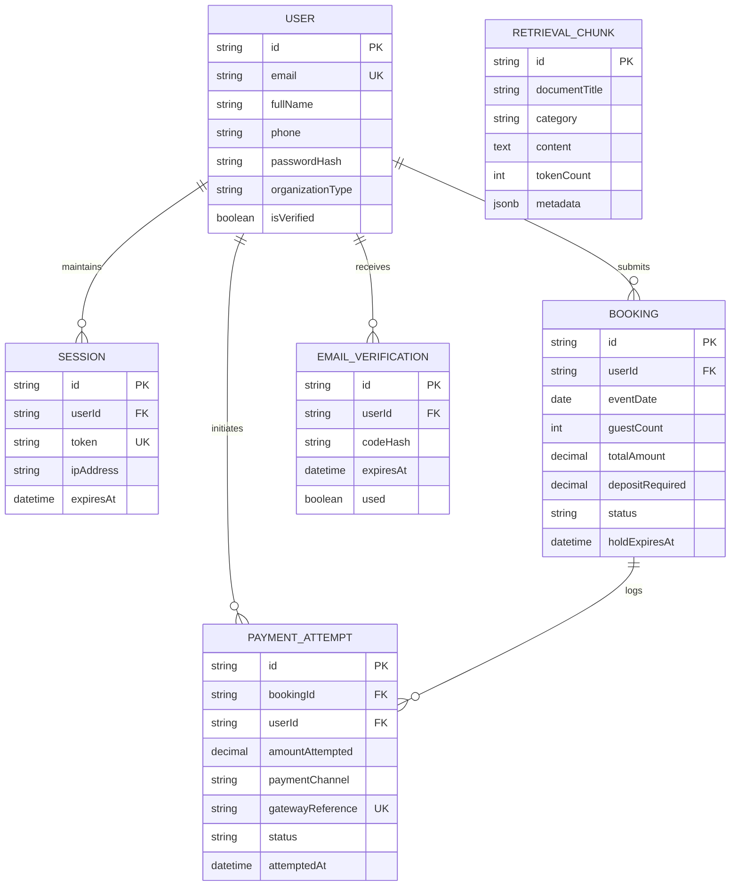

# Relational Database Schema Design and Integrity Architecture

## 1. Executive Summary

In Task Three, we proved that frontend form validation is solely an ergonomic convenience for well-behaved users; sending a direct HTTP request to `/api/bookings` completely bypassed client checks and inserted unvalidated records. In Task Four, the server becomes the strict, authoritative source of truth.

Before generating code or executing migrations, this document defines the relational database schema for Liz's Grillz Bookings across six core tables:
1. `User` (the system actors: corporate event organizers, private celebrants, administrators)
2. `Session` (authenticated state and hijacking resistance)
3. `Booking` (catering reservations, date holds, and contract deposit tracking)
4. `PaymentAttempt` (the immutable money-attempts ledger for payment telemetry, drop-off analysis, and tax audits)
5. `RetrievalChunk` (partitioned business policy, menu tiers, and pricing FAQ corpus for knowledge retrieval)
6. `EmailVerification` (cryptographic six-digit verification codes)

---

## 2. Table Specifications, Column Data Types, and Nullability

### Table 1: `User`
Stores authenticated event organizers, corporate procurement agents, and administrative accounts under the Nigerian Data Protection Act (NDPA).

| Column Name | Data Type | Nullable | Default | Description |
| :--- | :--- | :---: | :--- | :--- |
| `id` | `VARCHAR(36)` | No | `cuid()` | Immutable primary key identifier. |
| `fullName` | `VARCHAR(120)` | No | None | Legal first and last name required for catering service contracts. |
| `email` | `VARCHAR(255)` | No | None | Unique login and billing identifier, stored strictly lowercased. |
| `phone` | `VARCHAR(20)` | No | None | Contact number formatted in standard Nigerian E.164 (`+234...` or `080...`). |
| `passwordHash` | `VARCHAR(255)` | No | None | Adaptive cryptographic hash (Argon2id / bcrypt), never plaintext. |
| `organizationType`| `VARCHAR(50)` | No | `'Individual'` | Account classification (`'Corporate'`, `'Individual'`, `'Wedding'`, `'Religious'`). |
| `isVerified` | `BOOLEAN` | No | `false` | Email ownership confirmation status. |
| `createdAt` | `TIMESTAMPTZ` | No | `now()` | Timestamp of account registration. |
| `updatedAt` | `TIMESTAMPTZ` | No | `now()` | Timestamp of most recent profile modification. |

---

### Table 2: `Session`
Stores server-side session tokens to support instant revocation, multi-device tracking, and session hijacking prevention.

| Column Name | Data Type | Nullable | Default | Description |
| :--- | :--- | :---: | :--- | :--- |
| `id` | `VARCHAR(36)` | No | `cuid()` | Primary key. |
| `userId` | `VARCHAR(36)` | No | None | Foreign key referencing `User(id)` with cascading deletion. |
| `token` | `VARCHAR(255)` | No | None | Cryptographic session identifier stored as a SHA-256 hash. |
| `ipAddress` | `VARCHAR(45)` | No | None | IPv4 or IPv6 client origin address for location anomaly flags. |
| `userAgent` | `VARCHAR(512)` | No | None | Browser and operating system string to detect device hopping. |
| `expiresAt` | `TIMESTAMPTZ` | No | None | Absolute session expiration threshold (7 days from creation). |
| `createdAt` | `TIMESTAMPTZ` | No | `now()` | Timestamp when session was initiated. |

---

### Table 3: `Booking` (The Reservation & Agreed Money Table)
Tracks the core business agreement: reserving exclusive kitchen grilling slots, event headcount, and tracking deposit status.

| Column Name | Data Type | Nullable | Default | Description |
| :--- | :--- | :---: | :--- | :--- |
| `id` | `VARCHAR(36)` | No | `cuid()` | Primary key. |
| `userId` | `VARCHAR(36)` | No | None | Foreign key referencing the booking `User(id)`. |
| `clientName` | `VARCHAR(120)` | No | None | Snapshot of legal name at time of booking (denormalized). |
| `phone` | `VARCHAR(20)` | No | None | Emergency contact phone for kitchen logistics (denormalized). |
| `eventDate` | `DATE` | No | None | Target event calendar date (enforced max 2 large bookings per date). |
| `guestCount` | `INTEGER` | No | None | Expected headcount (minimum 20 guests, maximum 2,000 guests). |
| `packageTier` | `VARCHAR(50)` | No | `'StandardParty'`| Selected menu tier (`'MiniGrill'`, `'StandardParty'`, `'GrandBanquet'`). |
| `totalAmount` | `DECIMAL(12,2)`| No | None | Total agreed contract fee in Nigerian Naira (NGN). |
| `depositRequired`| `DECIMAL(12,2)`| No | None | Required reservation deposit (80% for Individual, 60% for Corporate). |
| `depositPaid` | `DECIMAL(12,2)`| No | `0.00` | Cumulative confirmed deposit funds received. |
| `status` | `VARCHAR(30)` | No | `'PENDING_HOLD'`| Reservation lifecycle state (`'PENDING_HOLD'`, `'CONFIRMED'`, `'COMPLETED'`, `'CANCELLED'`, `'EXPIRED'`). |
| `holdExpiresAt` | `TIMESTAMPTZ` | No | None | 48-hour expiration timestamp past which unreserved holds lapse. |
| `notes` | `TEXT` | Yes | `NULL` | Dietary constraints, meat selection, venue access details. |
| `createdAt` | `TIMESTAMPTZ` | No | `now()` | Creation timestamp. |
| `updatedAt` | `TIMESTAMPTZ` | No | `now()` | Last modification timestamp. |

---

### Table 4: `PaymentAttempt` (The Money-Attempts Ledger)
An append-only audit ledger recording every transaction attempt, whether completed, failed, timed out, or abandoned.

| Column Name | Data Type | Nullable | Default | Description |
| :--- | :--- | :---: | :--- | :--- |
| `id` | `VARCHAR(36)` | No | `cuid()` | Primary key. |
| `bookingId` | `VARCHAR(36)` | No | None | Foreign key referencing `Booking(id)`. |
| `userId` | `VARCHAR(36)` | No | None | Foreign key referencing `User(id)`. |
| `amountAttempted`| `DECIMAL(12,2)`| No | None | Attempted transaction sum in Nigerian Naira. |
| `paymentChannel`| `VARCHAR(40)` | No | None | Gateway method (`'PAYSTACK_CARD'`, `'FLUTTERWAVE_USSD'`, `'BANK_TRANSFER'`). |
| `gatewayReference`| `VARCHAR(100)`| Yes | `NULL` | External transaction reference emitted by payment aggregator. |
| `status` | `VARCHAR(30)` | No | `'INITIATED'` | Attempt outcome (`'INITIATED'`, `'SUCCESS'`, `'INSUFFICIENT_FUNDS'`, `'TIMEOUT'`, `'USER_ABANDONED'`, `'NETWORK_ERROR'`). |
| `errorCode` | `VARCHAR(50)` | Yes | `NULL` | Machine-readable failure token returned by gateway. |
| `errorMessage` | `VARCHAR(255)` | Yes | `NULL` | Human-readable explanation of rejection. |
| `ipAddress` | `VARCHAR(45)` | No | None | Origin IP address from which transaction was initiated. |
| `attemptedAt` | `TIMESTAMPTZ` | No | `now()` | Exact timestamp when payment was attempted. |

---

### Table 5: `RetrievalChunk` (Knowledge Retrieval Corpus)
Stores segmented knowledge chunks covering business rules, pricing tiers, refund terms, and catering FAQs for retrieval-augmented workflows.

| Column Name | Data Type | Nullable | Default | Description |
| :--- | :--- | :---: | :--- | :--- |
| `id` | `VARCHAR(36)` | No | `cuid()` | Primary key. |
| `documentTitle` | `VARCHAR(120)` | No | None | Origin document name (e.g. "Liz's Grillz 48-Hour Hold Terms"). |
| `category` | `VARCHAR(50)` | No | None | Topic domain (`'Pricing'`, `'Policies'`, `'Menu'`, `'Logistics'`). |
| `content` | `TEXT` | No | None | Text chunk content for linguistic search or embedding. |
| `tokenCount` | `INTEGER` | No | None | Precomputed token length to manage context window budgets. |
| `metadata` | `JSONB` | No | `'{}'` | Structural metadata (section headers, version number, source URL). |
| `createdAt` | `TIMESTAMPTZ` | No | `now()` | Timestamp when chunk was ingested. |

---

### Table 6: `EmailVerification`
Manages single-use, time-bound cryptographic email verification codes.

| Column Name | Data Type | Nullable | Default | Description |
| :--- | :--- | :---: | :--- | :--- |
| `id` | `VARCHAR(36)` | No | `cuid()` | Primary key. |
| `userId` | `VARCHAR(36)` | No | None | Foreign key referencing `User(id)` with cascading deletion. |
| `codeHash` | `VARCHAR(255)` | No | None | SHA-256 hash of the six-digit cryptographic code. |
| `expiresAt` | `TIMESTAMPTZ` | No | None | Expiration window timestamp (ten minutes post-generation). |
| `attempts` | `INTEGER` | No | `0` | Number of incorrect code attempts (locks after 5 failures). |
| `used` | `BOOLEAN` | No | `false` | Flag indicating whether code has already completed verification. |
| `createdAt` | `TIMESTAMPTZ` | No | `now()` | Timestamp of code issuance. |

---

## 3. Relational Cardinality

- **`User` to `Session`**: **One-to-Many**. A single event organizer can sign in concurrently across multiple devices (e.g. mobile phone at event venue, office laptop during contract reviews).
- **`User` to `Booking`**: **One-to-Many**. A corporate event coordinator books multiple seasonal events throughout the year.
- **`Booking` to `PaymentAttempt`**: **One-to-Many**. A customer frequently experiences network timeouts or telco USSD failures before completing a deposit, creating several attempt records tied to one reservation.
- **`User` to `PaymentAttempt`**: **One-to-Many**. Enables customer support to review all failed transactions initiated by a specific user across any of their events.
- **`User` to `EmailVerification`**: **One-to-Many**. A user may request a new code if their previous code expired.

---

## 4. Indexing Strategy and Write Costs

Every index added to a relational table accelerates reads at the direct expense of insert, update, and delete write throughput, as well as disk storage. Below is the technical justification and quantified write trade-off for every index:

1. **`User(email)` [Unique B-Tree]**:
   - **Why**: Evaluated on every login attempt, password recovery request, and signup duplicate check. Must execute in O(log N) time.
   - **Write Cost**: Minimal write overhead on user creation; requires index tree rebalancing and uniqueness constraint validation during registration.
2. **`Session(token)` [Unique B-Tree]**:
   - **Why**: Queried on every incoming authenticated HTTP request via middleware cookie extraction.
   - **Write Cost**: Incurred only during login and logout; negligible impact because session creation happens once per user visit.
3. **`Session(expiresAt)` [B-Tree]**:
   - **Why**: Required by background cron workers to purge expired sessions with `DELETE FROM "Session" WHERE "expiresAt" < NOW()` without executing a full sequential table scan.
   - **Write Cost**: Low; index page updates during session creation.
4. **`Booking(eventDate)` [B-Tree]**:
   - **Why**: Queried during capacity validation to enforce the business rule that Liz's Grillz accepts a maximum of two large catering events on any given calendar day.
   - **Write Cost**: Moderate; written once per booking creation. Prevents slow sequential table scans as the booking archive scales into thousands of records.
5. **`Booking(userId, status)` [Composite B-Tree]**:
   - **Why**: Powers the organizer dashboard filter: "Show all my confirmed bookings".
   - **Write Cost**: Moderate composite key overhead on booking status transitions.
6. **`PaymentAttempt(gatewayReference)` [Unique B-Tree]**:
   - **Why**: Queried asynchronously when Paystack or Flutterwave webhooks deliver payment notifications to guarantee idempotent processing (preventing duplicate deposit credits).
   - **Write Cost**: Low; written once upon payment initiation.
7. **`PaymentAttempt(bookingId, attemptedAt)` [Composite B-Tree]**:
   - **Why**: Accelerates rendering of the financial ledger on the event organizer's invoice screen.
   - **Write Cost**: Incurred on each payment attempt; critical for chronological dispute resolution.
8. **`RetrievalChunk(category, documentTitle)` [Composite B-Tree]**:
   - **Why**: Enables scoped semantic filtering (e.g. limiting search exclusively to "Policies" or "Pricing").
   - **Write Cost**: Incurred only during administrative ingestion; retrieval corpus is read-heavy (99% reads, 1% writes).

---

## 5. Intentional Denormalization: Storing the Same Fact Twice

Strict third normal form (3NF) dictates that every non-key attribute must depend on the key, the whole key, and nothing but the key, with zero redundant data across tables. However, production financial and catering systems accept controlled denormalization for legal and operational resilience:

### Fact 1: `Booking.clientName` and `Booking.phone`
- **Where else stored**: In `User.fullName` and `User.phone`.
- **Why accepted**: A booking contract represents an immutable legal point-in-time snapshot. If an organizer updates their profile name or telephone number six months later, the historical catering agreement, food safety compliance log, and invoice generated for an earlier event must preserve the exact legal entity and emergency contact telephone that executed that booking. Storing this fact directly on `Booking` avoids destructive historical mutation and enables kitchen logistics dispatchers to view emergency phone numbers without executing relational database joins during field outages.

### Fact 2: `Booking.depositPaid`
- **Where else stored**: Derived as the sum of all successful rows in `PaymentAttempt WHERE status = 'SUCCESS'`.
- **Why accepted**: Calculating cumulative deposit balance via an aggregate `SUM()` query across millions of `PaymentAttempt` records on every calendar view degrades database read performance. Storing a verified running balance on `Booking` enables O(1) status queries while cross-checking against the append-only `PaymentAttempt` audit table during reconciliation.

---

## 6. The Money-Attempts Table: UX Drop-Off and Legal Provenance

Unlike basic applications that only record successful transactions, Liz's Grillz Bookings implements an independent, append-only `PaymentAttempt` table. This is justified by two operational requirements:

1. **UX Funnel Drop-Off Telemetry**:
   - Online payments in Nigeria frequently fail due to telco USSD timeouts, bank network downtimes (NIBSS latency), or user card limits. Logging failed and abandoned attempts reveals precisely where clients encounter friction (e.g., if 40% of corporate clients abandon bank transfers due to delayed token OTPs).
2. **Litigation, Regulatory Inquiries, and Tax Audits**:
   - In commercial food catering, disputed dates and chargebacks create substantial financial liability. If a customer claims they paid a deposit to reserve December 24 and demands compensation when another event is catered, or if a payment gateway double-charges a card, the append-only attempt table provides undeniable forensic proof containing origin IP addresses, timestamps, gateway error tokens, and transaction references.

### Tax Authority Investigation Scenario (LIRS / FIRS Audit)

If the Lagos State Internal Revenue Service (LIRS) or Federal Inland Revenue Service (FIRS) audits Liz's Grillz fourteen months post-transaction and demands a full accounting of a specific NGN 750,000 corporate banquet deposit, we would execute the following forensic procedure:

Rather than relying on mutable application state or ephemeral browser logs, we query the `PaymentAttempt` table by the unique `gatewayReference` or date range, which links directly to the immutable `Booking` and `User` records. We extract the exact ISO 8601 timestamp, origin IP address, settlement account identifier, and external payment aggregator transaction receipt ID. We then cross-reference this record against our settled bank account statements and the payment processor's cryptographic webhook payload, proving whether the NGN 750,000 was a taxable revenue deposit, a failed attempt that never settled, or a refunded cancellation. Because `PaymentAttempt` is strictly append-only and cannot be updated or deleted by application users, it serves as tamper-evident, court-admissible financial evidence that satisfies all statutory tax compliance obligations.

